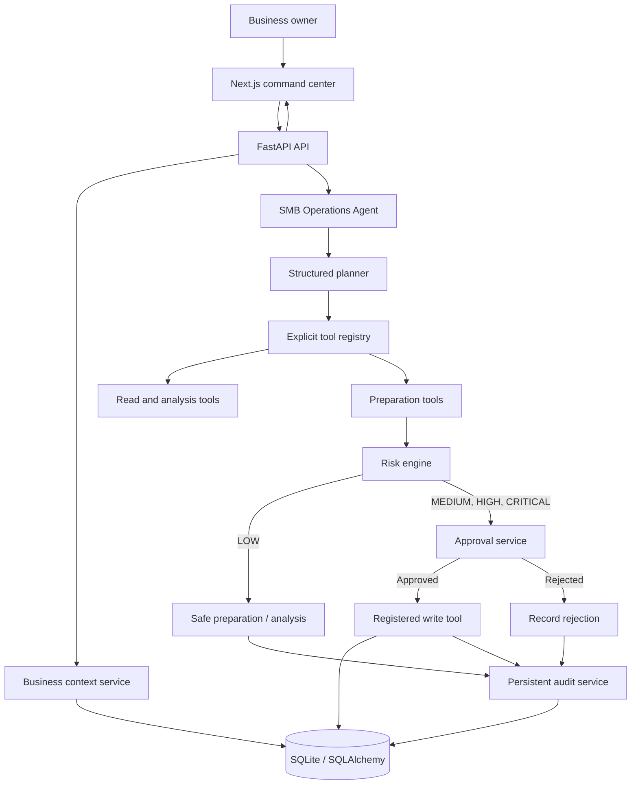
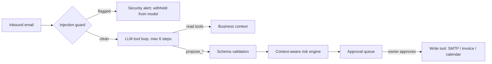

# SMB OS architecture

## Request lifecycle

## Backend boundaries

- `backend/main.py` owns HTTP validation, route-level errors, and app startup.
- `backend/database.py` owns the SQLAlchemy engine and request-scoped sessions.
- `backend/models.py` contains users, customers, emails, tasks, invoices, calendar events, agent runs/actions, approvals, and audit records.
- `backend/services/business_context.py` reads joined business signals for planning.
- `backend/agents/planner.py` uses a bounded structured function call when configured; its offline planner keeps the seeded demo working without a provider.
- `backend/agents/orchestrator.py` creates a persisted run, chooses registered workflows, prepares actions, and produces a concise trace without exposing private reasoning.
- `backend/tools/` contains explicit read and write integrations. The agent does not mutate ORM rows directly.
- `backend/risk_engine.py` classifies every prepared write. `backend/services/approvals.py` is the only path that executes registered external write tools.
- `backend/services/audit.py` records preparations, task updates, approval decisions, and executions.

## Agent loop and safety path

The model supplies a company name only; recipients and IDs are resolved from records server-side.

## Action risk policy

| Level | Example | Behavior |
| --- | --- | --- |
| LOW | Read, classify, calculate, draft | Runs without approval; drafts remain clearly labeled |
| MEDIUM | Send an email, schedule a customer meeting | Requires approval |
| HIGH | Create an invoice, modify a customer record | Requires approval |
| CRITICAL | Refund, destructive change, financial transaction | Requires explicit approval |

Context can only raise a level (unknown recipient, key account, large or out-of-pattern invoice). Unknown actions default to HIGH. The tool executor uses an allow-list; model output cannot choose Python functions, shell commands, or arbitrary database operations.

## Demo data relationships

First startup seeds an owner, 20 customers, 50 conversations, 25 tasks, 20 invoices, 15 meetings, and 105 historical activity entries. Acme Corp intentionally has unresolved negative support conversations, a ₹25,000 invoice 12 days overdue, and an upcoming check-in. The seeded records support the autopilot and cross-system prioritization demo without real customer communication.

## Runtime and provider failure

SQLite and demo reads need no AI credentials. If `OPENAI_API_KEY` is absent or the provider call fails, the agent uses its bounded offline workflow planner and the UI remains usable. The email and calendar tools are mock providers for the hackathon; approval records and resulting timeline changes are real local database writes.
